# AES-GCM File-Crypter
<br></br>

## About
This application has a GUI and a CLI for securely encrypting or decrypting files and/or entire folders with AES-GCM cryptography and forensic recovery-prevention features. \
</br>

## Why Choose AES-GCM Cryptography?
AES-GCM Cryptography is one of the most secure and modern approaches for encryption and decryption. It supports three key sizes (128, 192, and 256 bits). \
</br>

## Forensic Recovery-Prevention Features:

### 1.) RAM Data-Recovery Prevention
During encryption or decryption, any sensitive data, that would normally remain in the device's RAM until the application closes, is immediately cleared once the operation finishes.

This feature is designed to prevent recovery of processed data from the device’s RAM.

### 2.) Disk Data-Recovery Prevention
After encryption or decryption:
* A temporary file is created to hold the processed data.
* The original file is overwritten with random bytes and then deleted.
* The temporary file is renamed to the original file’s name.
  
This feature is designed to prevent recovery of the original file’s contents from the device’s disk.
<br></br>

## GUI Usage (Windows):
The GUI for Windows will be coming soon to the Microsoft store.

### 1.) Select a folder or file to encrypt or decrypt

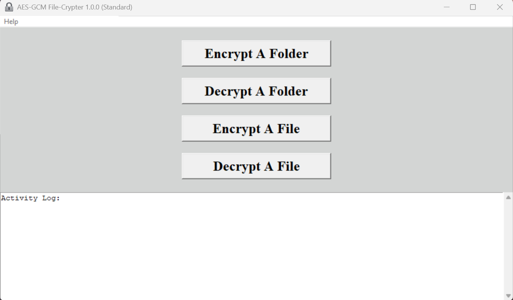
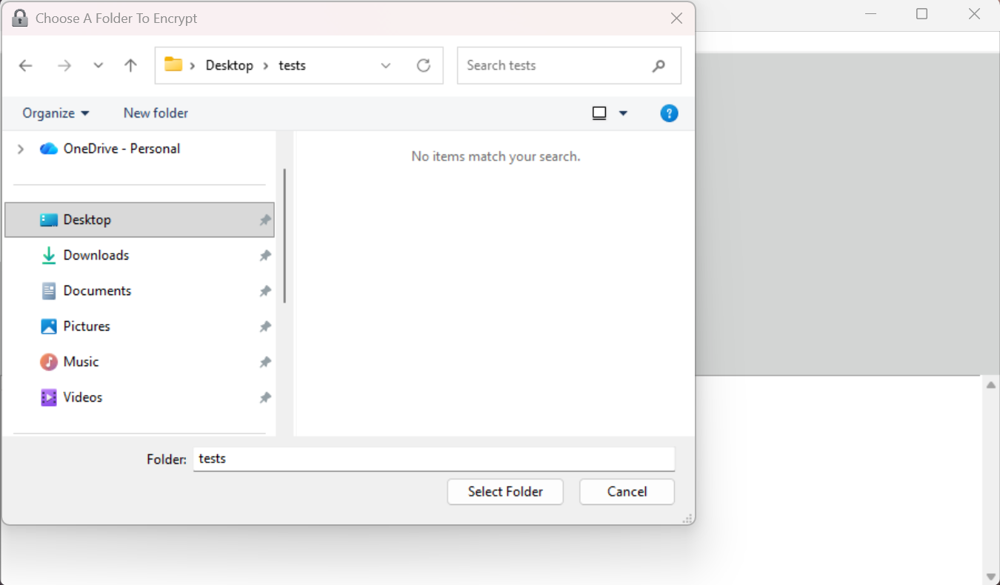

### 2.) Create or enter the password  

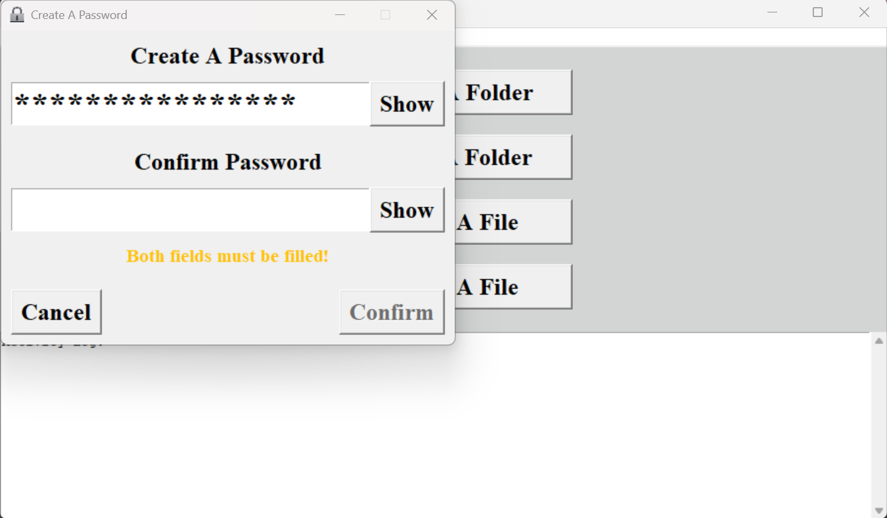
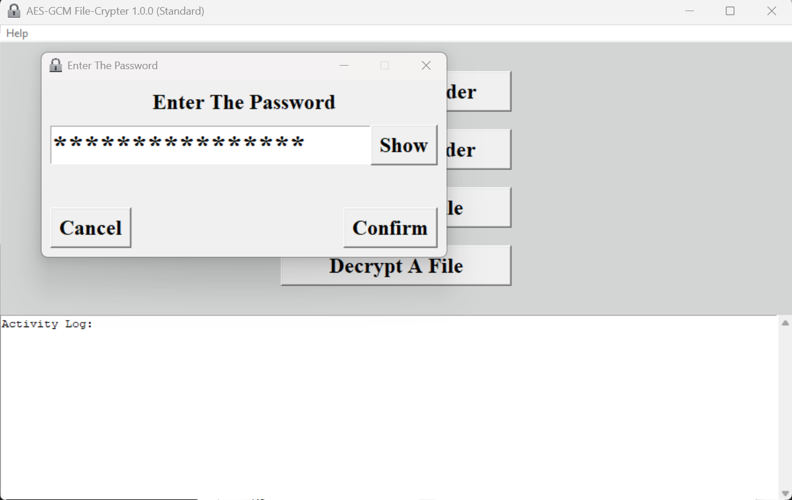  

### 3.) Choose a key-size (If encrypting)

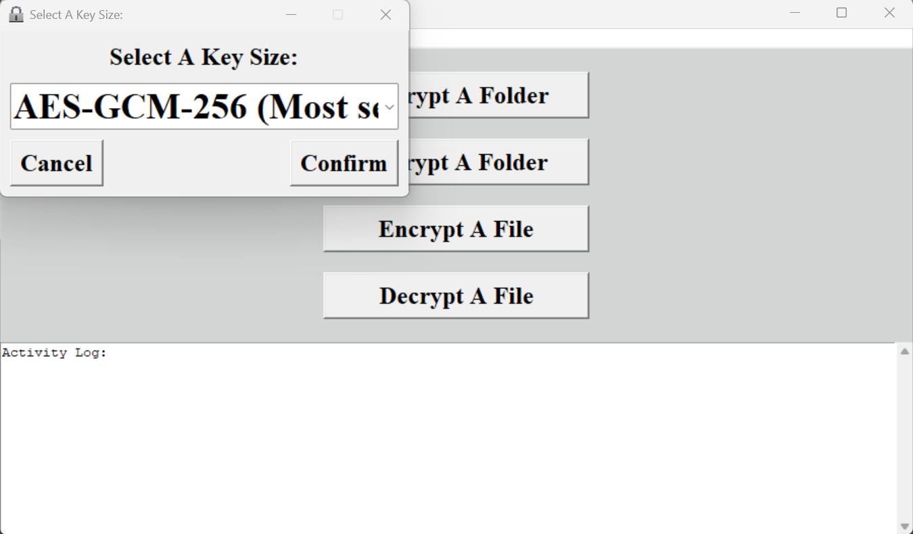

### 4.) Wait for the progressbar to finish and that's it!

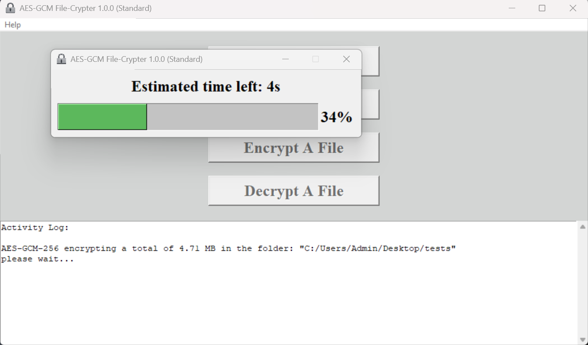

<br></br>

## GUI Usage (Linux):

### 1.) Select a folder or file to encrypt or decrypt

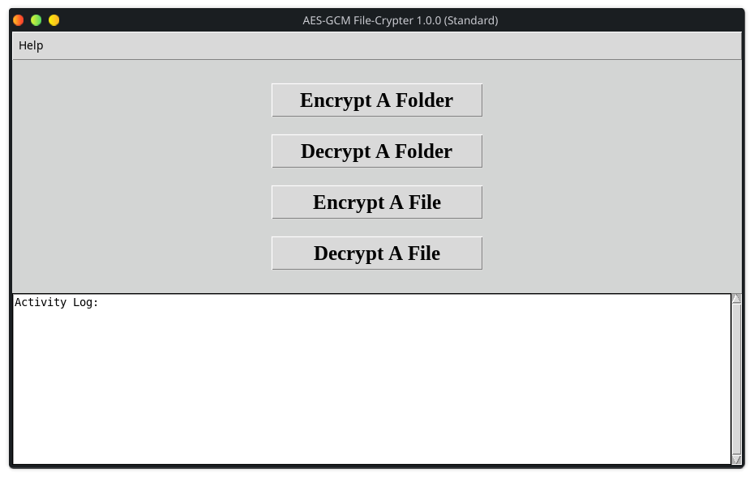
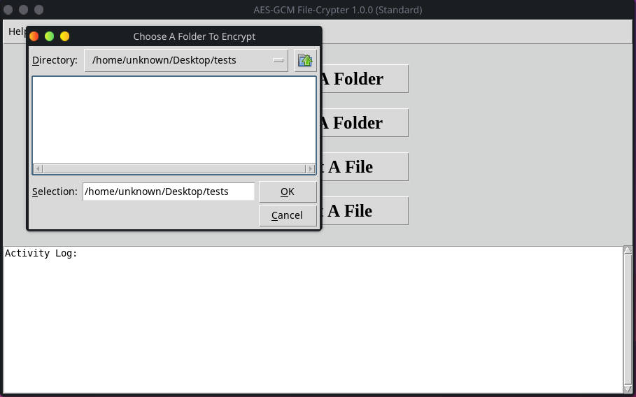

### 2.) Create or enter the password  

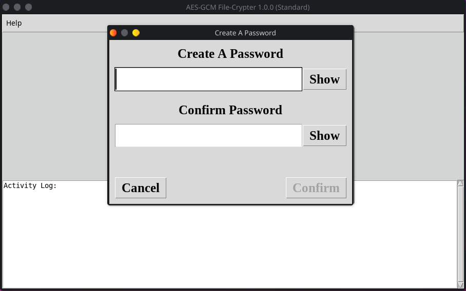  
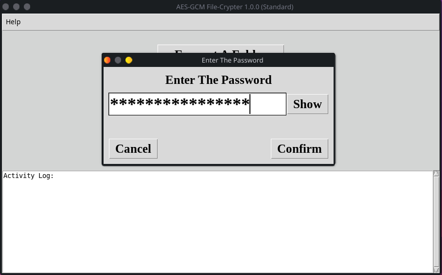

### 3.) Choose a key-size (If encrypting)

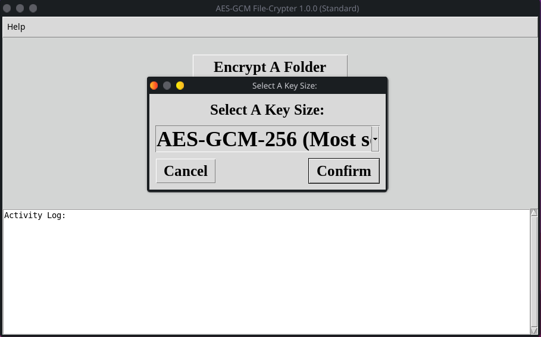

### 4.) Wait for the progressbar to finish and that's it!

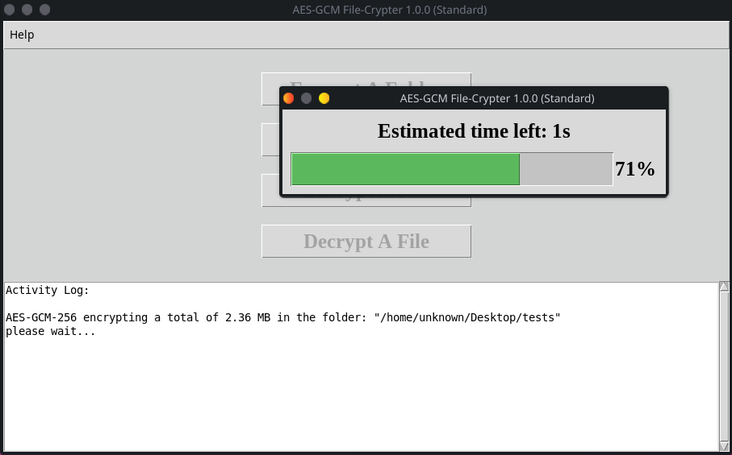

<br></br>

## Compile From Source (Optional):  

### Windows:
1.) Ensure the latest Python, PyInstaller, and any required dependencies are installed. \

2.) Open a terminal, navigate to this file’s directory, and run: \
```python -m PyInstaller --clean --noconfirm --onefile --windowed --icon=assets/icon/ico/icon.ico --add-data "assets;assets" "AES-GCM File-Crypter.pyw"```  

### Linux:
1.) Ensure the latest Python, PyInstaller, and any required dependencies are installed. \

2.) Open a terminal, navigate to this file’s directory, and run: \
```python -m PyInstaller --clean --noconfirm --onefile --windowed --icon="assets/icon/ico/icon.ico" --add-data "assets:assets" --hidden-import=_cffi_backend --collect-binaries cffi --collect-data cffi "AES-GCM File-Crypter.pyw"```
