# AES-GCM File-Crypter (Standard) 1.0.1
<br></br>

## About
This application has a GUI and a CLI for securely encrypting or decrypting files and/or entire folders using AES-GCM cryptography with basic forensic recovery-prevention features. The Standard edition GUI and CLI will continue to remain free, source-available, and maintained with updates when necessary.
<br></br>

Please note:
* A Forensic edition GUI will be released soon that includes a KDF iterations drop-down option and an OS-specific metadata wipe screen to wipe all traces of the original file's content during encryption from the device being used, at a price of $20 CAD/copy.
* A Pro edition including the Forensic edition GUI and an upgraded CLI with the OS-specific metadata wipe option will be released, at a price of $50 CAD/copy.
* A Pro+ edition may later be released that will include all the features of the Pro edition plus an option to forensically wipe metadata from a disk or USB and reformat it so no data is left recoverable, before copying encrypted files to it, at a price of $100/copy. 
<br></br>

## Why Choose AES-GCM Cryptography?
AES-GCM Cryptography is one of the most secure and modern approaches for encryption and decryption. It supports three key sizes (128, 192, and 256 bits).
<br></br>

## Forensic Recovery-Prevention Features:

### 1.) RAM Data-Recovery Prevention
During encryption or decryption, any sensitive data, that would normally remain in the device's RAM until the application closes, is immediately cleared once the operation finishes.

This feature is designed to prevent recovery of processed data from the device’s RAM.

### 2.) Disk Data-Recovery Prevention
After encryption or decryption:
* A temporary file is created to hold the processed data.
* The original file is overwritten with random bytes and then deleted.
* The temporary file is renamed to the original file’s name.
  
This feature is designed to prevent recovery of the original file’s contents from the device’s disk.
<br></br>

## GUI Install (Windows)
The GUI for Windows will be coming soon to the Microsoft Store. \
The CLI that includes a GUI can be downloaded via Python's pip (See the CLI section).
<br></br>

## GUI Usage (Windows):

### 1.) Select a folder or file to encrypt or decrypt

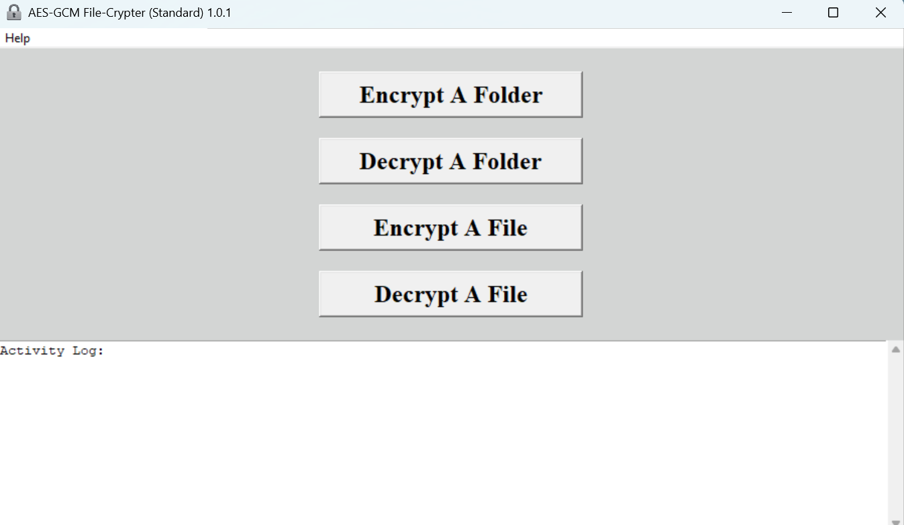
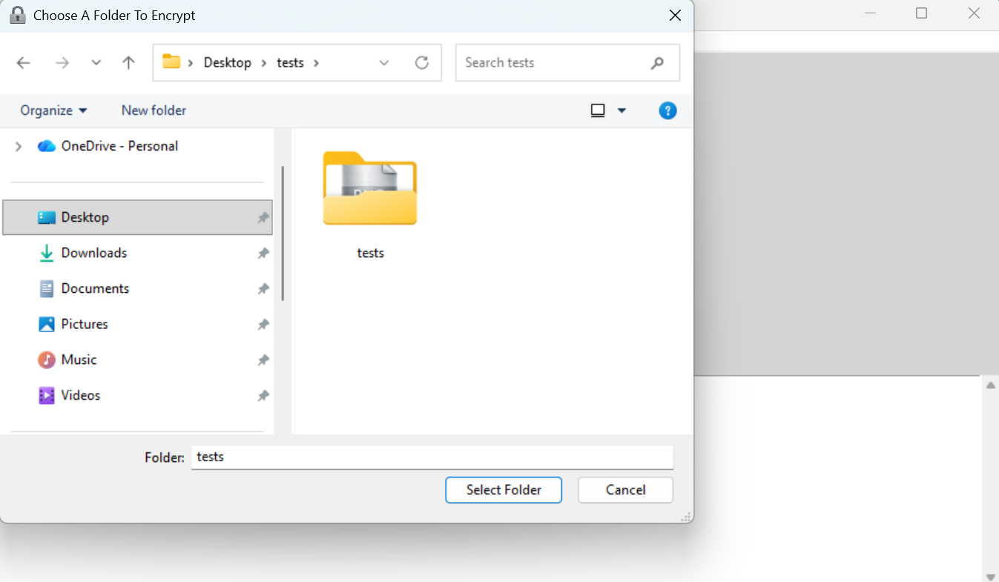

### 2.) Choose a key-size (If encrypting)

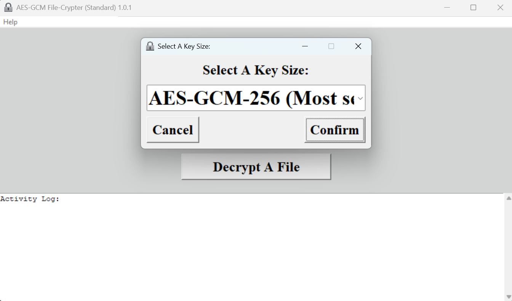

### 3.) Create or enter the password  

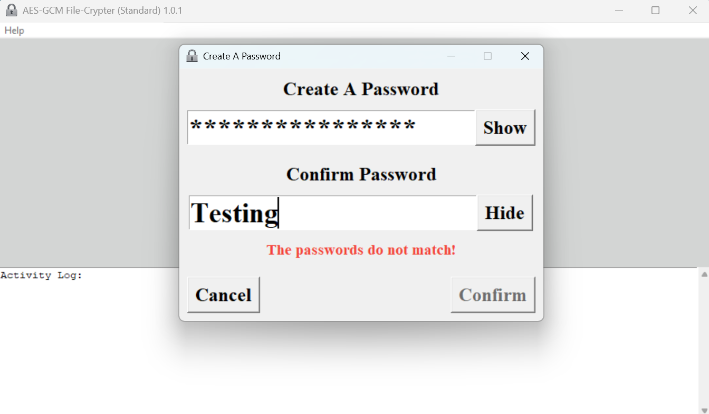
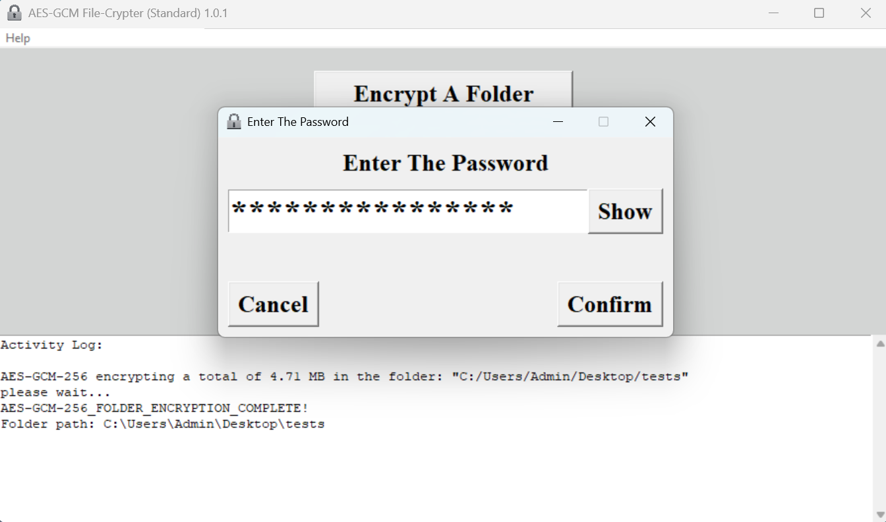

### 4.) Wait for the progressbar to finish and that's it!

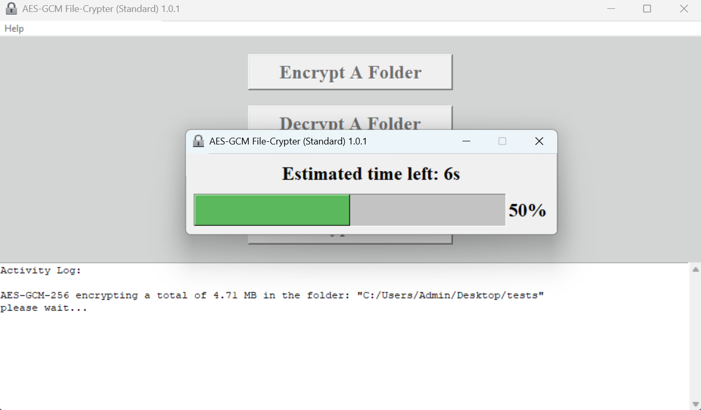
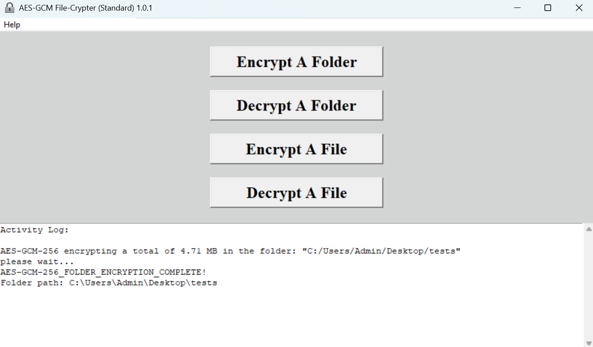

<br></br>

## GUI Install (Linux)
The CLI that includes a GUI can be downloaded via Python's pip (See the CLI section).
<br></br>

## GUI Usage (Linux):

### 1.) Select a folder or file to encrypt or decrypt

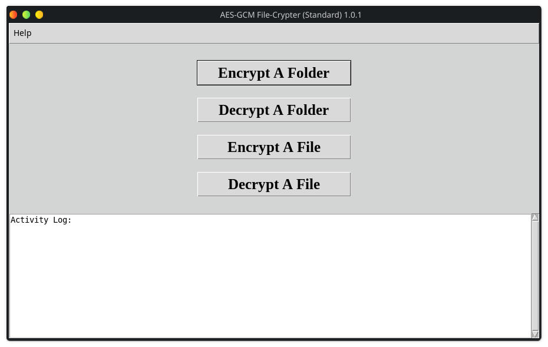
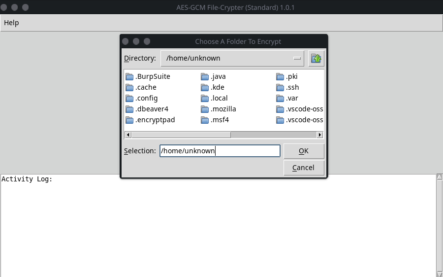

### 2.) Choose a key-size (If encrypting)

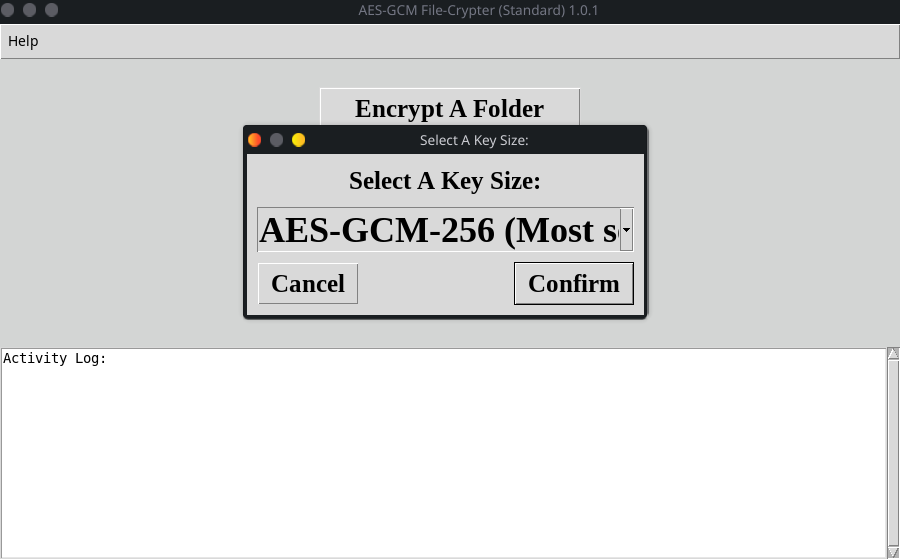

### 3.) Create or enter the password  

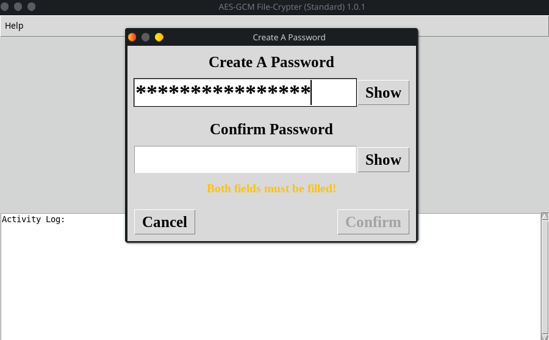  
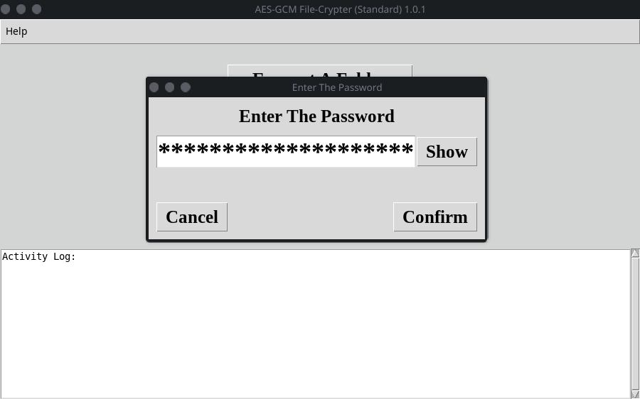

### 4.) Wait for the progressbar to finish and that's it!

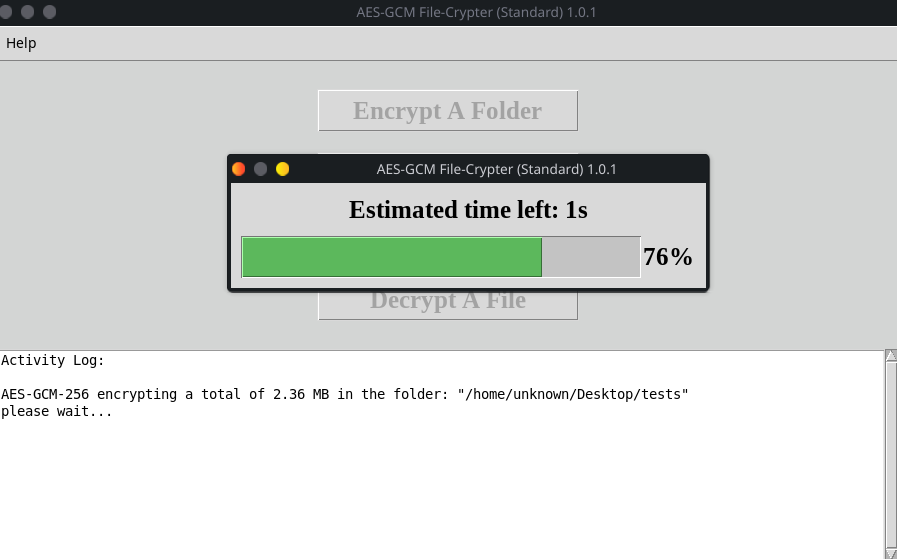
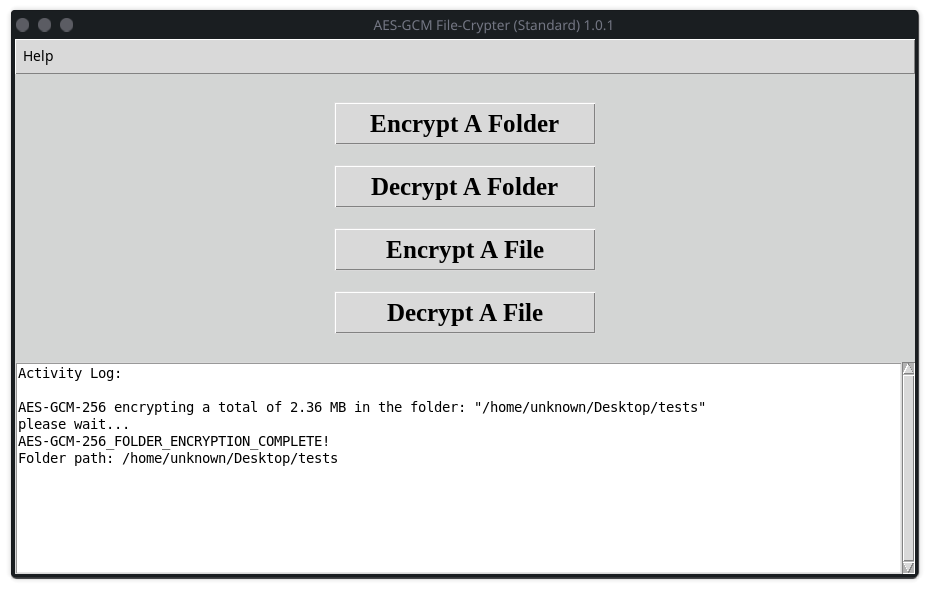

<br></br>

## GUI Install (Mac)
```UNTESTED```
<br></br>

## GUI Usage (Mac):
```UNTESTED```
<br></br>

## Compile From Source (Optional):  

### Windows:
1.) Ensure the latest Python, PyInstaller, and any required dependencies are installed. \
2.) Open a terminal, navigate to this file’s directory, and use the following command.
*  ```python -m PyInstaller --clean --noconfirm --onefile --windowed --icon=assets/icon/ico/icon.ico --add-data "assets;assets" "AES-GCM File-Crypter.pyw"```  

### Linux:
1.) Ensure the latest Python, PyInstaller, and any required dependencies are installed. \
2.) Open a terminal, navigate to this file’s directory, and use the following command.
*  ```python -m PyInstaller --clean --noconfirm --onefile --windowed --icon="assets/icon/ico/icon.ico" --add-data "assets:assets" --hidden-import=_cffi_backend --collect-binaries cffi --collect-data cffi "AES-GCM File-Crypter.pyw"```

### Mac:
```UNTESTED```
<br></br>

## CLI Install For All OS' (Local):
### 1.) Ensure the latest Python is installed.
### 2.) Open a terminal in the "python_package" directory and use the following command.
*  ```pip install .```
<br></br>

## CLI Install For All OS':
### 1.) Ensure the latest Python is installed.
### 2.) Open a terminal and use the following command.
* ```pip install aes-gcm-file-crypter==1.0.1```

## Visit The PyPi Repository
* [PyPi Repository](https://pypi.org/project/aes-gcm-file-crypter/)
<br></br>

## CLI Usage For All OS':
### 1.) For general CLI instructions use the following command.
* ```python -m aes_gcm_file_crypter --help```
### 2.) For detailed instructions of each function use the following:
* ```python -m aes_gcm_file_crypter encrypt_folder --help```
* ```python -m aes_gcm_file_crypter decrypt_folder --help```
* ```python -m aes_gcm_file_crypter encrypt_file --help```
* ```python -m aes_gcm_file_crypter decrypt_file --help```
